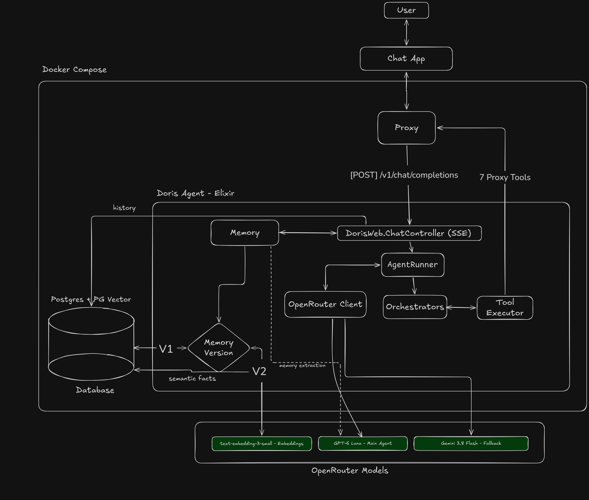
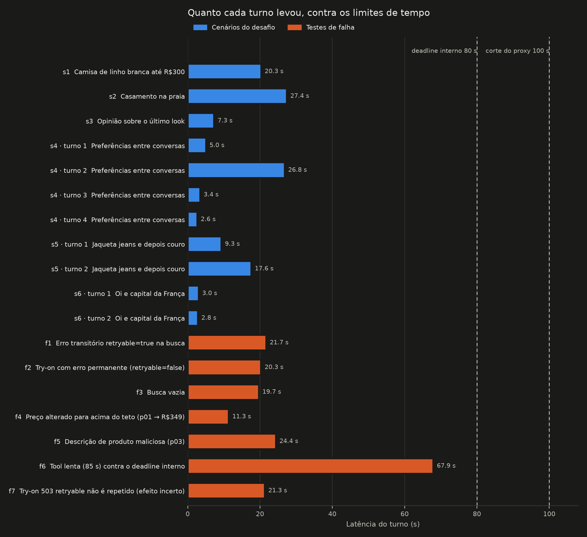

# Agente da Doris

Agente em Elixir/Phoenix que conversa com o proxy no formato OpenAI (SSE), busca peças, monta looks, gera
try-on e lembra das preferências de cada pessoa entre conversas.

Se quiser os detalhes de cada passo, deixei tudo em `code-agent/`: o [plano](code-agent/plan.md), o
[log com horários e commits](code-agent/log.md), as [decisões](code-agent/decisions.md) e os
[testes](code-agent/testing.md). Os relatórios dos testes ponta a ponta ficam em [`evals/reports/`](evals/reports/), e o gráfico sai de
`evals/charts.py`.

## Ideia e arquitetura



A ideia central é simples: **o modelo decide o que fazer, o código garante que seja feito do jeito certo.**

O LLM não chama as tools do proxy diretamente. Ele enxerga sete tools de mais alto nível, e cada uma é um
pequeno pipeline em Elixir:

| Tool que o modelo vê | O que acontece por trás |
| --- | --- |
| `find_products` | busca no catálogo e filtra por preço e cores que a pessoa evita |
| `recommend_outfit` | uma busca por peça (camisa, calça, sapato…) para montar o look |
| `show_products` | mostra os cards, conferindo de novo preço, cor e se o ID é conhecido |
| `try_on` | cria a peça, gera o try-on (sempre uma peça) e mostra; se falhar, mostra o card do produto |
| `get_looks` / `show_look` | busca os looks da pessoa, manda as imagens para o modelo avaliar e mostra o escolhido |
| `get_wardrobe` | lista o guarda-roupa |

Assim, o que não pode dar errado não depende do prompt: a ordem garment → try-on, uma peça por vez, o try-on
sempre aparecer para a pessoa, o teto de preço e as cores proibidas.

Mais três peças que seguram o resto:

- **Só IDs reais.** Produtos, peças, try-ons e looks só podem ser usados se vieram de uma resposta do proxy na
  mesma conversa. Se o modelo inventar um ID, ele recebe um erro e o proxy nem é chamado.
- **Histórico no Postgres.** O proxy manda só a mensagem atual, então o agente guarda a conversa. Ela é gravada
  durante o turno, não só no fim: se algo quebrar no meio, a mensagem, as tools e os IDs já estão salvos.
- **Memória em duas camadas.** A v1 guarda um perfil estruturado (tamanho, cores que a pessoa evita, estilo,
  orçamento). A v2, que é o padrão, soma a isso fatos livres com embeddings ("gosta de festas", "vai de bicicleta
  para o trabalho"). As restrições duras, como cor proibida, sempre vêm da v1: não confio num top-k para isso.

## Decisões e trade-offs

- **Elixir puro, sem framework de agente.** O loop é uma função recursiva curta e o estado do turno é uma struct.
  Sem GenServer, sem Oban, sem macros. Perco as conveniências do LangGraph (checkpoints, tracing pronto), mas o
  fluxo fica fácil de ler e de testar.
- **O texto da resposta não é streamado token a token.** As chamadas ao LLM são normais e eu faço o SSE para o
  proxy. O loop de tools fica bem mais simples, e as linhas de progresso ("Buscando…", "Gerando seu try-on…")
  cobrem a espera.
- **A memória é extraída em paralelo e esperada antes de fechar o turno.** Assim, uma conversa nova já enxerga o
  que acabou de ser dito. Custa uma chamada de LLM a mais por turno, mas quase não aumenta a latência.
- **Modelos.** `openai/gpt-6-luna` faz o trabalho principal, inclusive visão e extração de memória; o
  `google/gemini-3.8-flash` só entra se o Luna falhar. Comecei com o Gemini na memória, mas ele truncava o JSON
  em mais ou menos metade das vezes, então troquei. Tudo é configurável por variável de ambiente.
- **Falhas.** Cada chamada ao LLM tem até 20 s, sempre dentro do limite de 80 s do turno, para sobrar tempo para o
  fallback. A memória tenta de novo sozinha em caso de erro temporário. E try-on e cards não são repetidos quando
  não dá para saber se a primeira chamada já surtiu efeito, para não duplicar nada na tela.
- **Filtro de cor por palavras.** A busca não devolve tags, então uso o nome e a descrição, com uma lista de tons
  ("amarelo" também pega "mostarda" e "ocre"). É simples e previsível, mas é uma lista fixa.
- **Testes de falha sem mexer no proxy.** Subo uma segunda cópia do proxy com os arquivos de falha e de catálogo
  que ele já aceita (`FAULTS_FILE`, `CATALOG_OVERRIDES_FILE`).

## Como ficou

Rodei tudo contra o proxy de verdade, com o modelo de verdade. "Passou" quer dizer que o runner conferiu o que
saiu no SSE (texto, cards, `[DONE]`) e a sequência de tools no log do proxy, não só o tempo.

| O que | Resultado |
| --- | --- |
| Os 6 cenários do desafio | 6/6 em todas as rodadas |
| Falhas: erro temporário, erro permanente, busca vazia, preço alterado, prompt injection, tool lenta, try-on instável | 7/7 |
| Memória v1 × v2 (preferências, fato indireto, fatos acumulados) | v1 2/3 · v2 3/3 |
| Testes automatizados (`mix test`) | 64 testes passando |



*Latência de ponta a ponta de cada turno, medida pelo runner E2E: inclui as chamadas ao modelo, as tools e o
fechamento do SSE. Uma execução por caso (a última rodada), em Docker. São 18 turnos de complexidade bem
diferente, então isso mostra que tudo cabe nos limites, não serve como benchmark nem para tirar percentis.*

O único turno que chega perto do limite é o f6, de propósito: a busca foi atrasada em 85 s. Pelos logs, o
agente desistiu de cada tentativa aos 30 s, tentou a busca uma segunda vez (ela não tem efeito colateral),
bloqueou uma terceira chamada igual que o modelo pediu e respondeu "não consegui consultar o catálogo agora",
fechando o turno com `[DONE]` aos 67,9 s.

Um detalhe que esse teste revelou: quem desiste é o agente. O proxy continua processando a chamada lenta e só
termina depois (no log dele as duas buscas aparecem com status 200). Para uma busca isso é inofensivo. Para um
try-on, significa que ele pode ficar pronto depois que o agente já desistiu, e nunca ser mostrado.

Alguns casos, como ID inventado, argumento inválido e loop sem progresso, não dá para provocar de forma
confiável com o modelo real. Esses ficaram cobertos por testes com respostas do modelo simuladas.

## O que ficou de fora e por quê

- **Streaming token a token:** preferi acertar o loop de tools primeiro.
- **Try-on com várias peças ao mesmo tempo:** o proxy não suporta. A Doris prova a peça principal e mostra o
  resto como cards.
- **Criar peça a partir de foto enviada:** o proxy também não suporta. A foto vai para o modelo só para ele
  opinar.
- **Avaliar se o look "faz sentido":** os testes conferem tools, cards, preço e cor, mas não gosto.
- **Banco fora do ar:** hoje o turno falha com erro. Responder sem histórico e sem memória tinha risco de deixar
  o estado inconsistente, então deixei para depois.
- **Memória v2 mais esperta:** falta juntar fatos parecidos e expirar os antigos.
- **Chamadas abandonadas no proxy:** quando o agente desiste por timeout, não há como cancelar a chamada do lado
  do proxy. Um try-on que estoura o tempo pode ser gerado mesmo assim e ficar sem ser mostrado.
- **Métricas e tracing:** por enquanto são só logs estruturados e a tabela de execuções de tools.

## Próximos passos

1. Limitar o timeout das tools pelo tempo que resta no turno, como já é feito com o LLM (hoje é fixo em 30 s),
   e, depois de um try-on que estourou o tempo, conferir em `looks` se ele foi gerado para mostrá-lo.
2. Streamar o texto da resposta final.
3. Economizar a chamada extra de memória quando a mensagem claramente não fala da pessoa.
4. Usar o guarda-roupa nas sugestões ("combina com sua calça jeans").
5. Um LLM-juiz para avaliar a coerência dos looks, com mais variações dos cenários.
6. Telemetria por turno: latência por tool, tokens e custo.

## Como usei IA

Usei o Claude Code do começo ao fim, guiado por um plano de tarefas que escrevi antes (T01 a T14). A regra era:
nenhuma tarefa fechava sem teste rodando no Docker e evidência real anotada no log.

Ajudou muito no esqueleto do Phoenix e do Docker, nos orquestradores, nos testes com stubs e no runner de testes
ponta a ponta. Também foi útil para investigar problemas medindo em vez de chutar: foi assim que descobri que o
Gemini truncava o JSON da memória.

Também errou, e precisei pegar:

- um despacho de tools que funcionava na release e quebrava nos testes;
- a configuração gerada que forçava HTTPS e a imagem final com glibc incompatível;
- respostas em markdown, que o frontend não renderiza;
- no primeiro teste da memória, a resposta parecia certa por coincidência: só olhando o banco vi que nada tinha
  sido salvo;
- fatos da memória que supunham o gênero da pessoa ("Ela gosta de…");
- uma asserção errada no teste de busca vazia.

## Início e fim

- Início: 2026-11-15 20:31:12 -03:00
- Fim: 2026-11-15 23:30:54 -03:00 (o núcleo, T01 a T10, ficou pronto às 21:25; depois vieram a recuperação de
  falhas e os ajustes)

## Como rodar

Só precisa de Docker com Compose e Git.

```bash
cp .env.example .env         # coloque sua OPENROUTER_API_KEY
docker compose up --build    # frontend + proxy (:3000), agente e Postgres
```

Depois é só abrir http://localhost:3000.

| Para… | Comando |
| --- | --- |
| Rodar os testes | `docker compose --profile test run --rm agent-test` |
| Rodar os 6 cenários | `docker compose --profile test run --rm agent-test mix run --no-start evals/run.exs evals/scenarios.json` |
| Rodar os testes de falha | `docker compose --profile eval up --build -d proxy-faults agent-eval` e depois o mesmo comando com `evals/faults.json` |
| Usar só a memória v1 | `MEMORY_MODE=v1 docker compose up --build -d` |

Outras variáveis, todas opcionais: `AGENT_MODEL`, `FALLBACK_MODEL`, `MEMORY_MODEL`, `EMBEDDING_MODEL`,
`LLM_MAX_TOKENS`, `LLM_TIMEOUT_MS` e `DB_PORT` (porta local do Postgres, padrão 5433).
